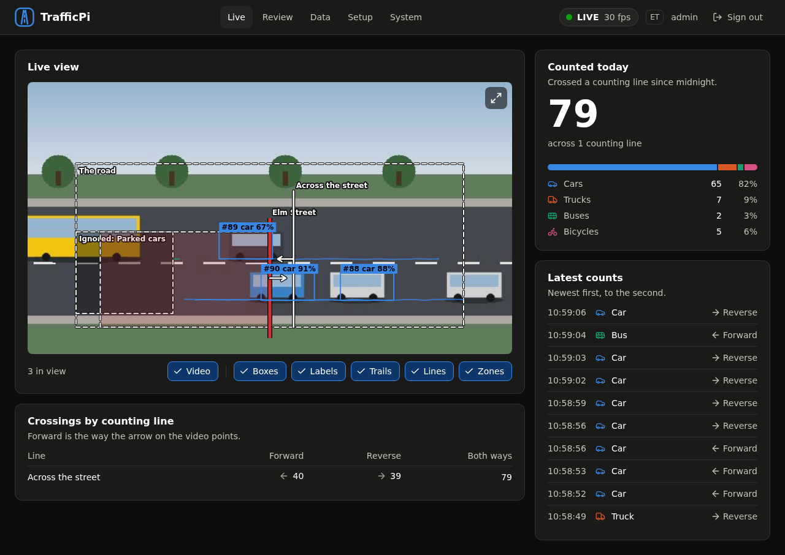
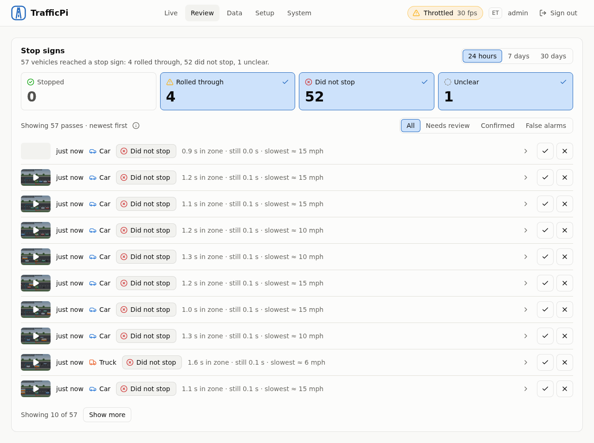
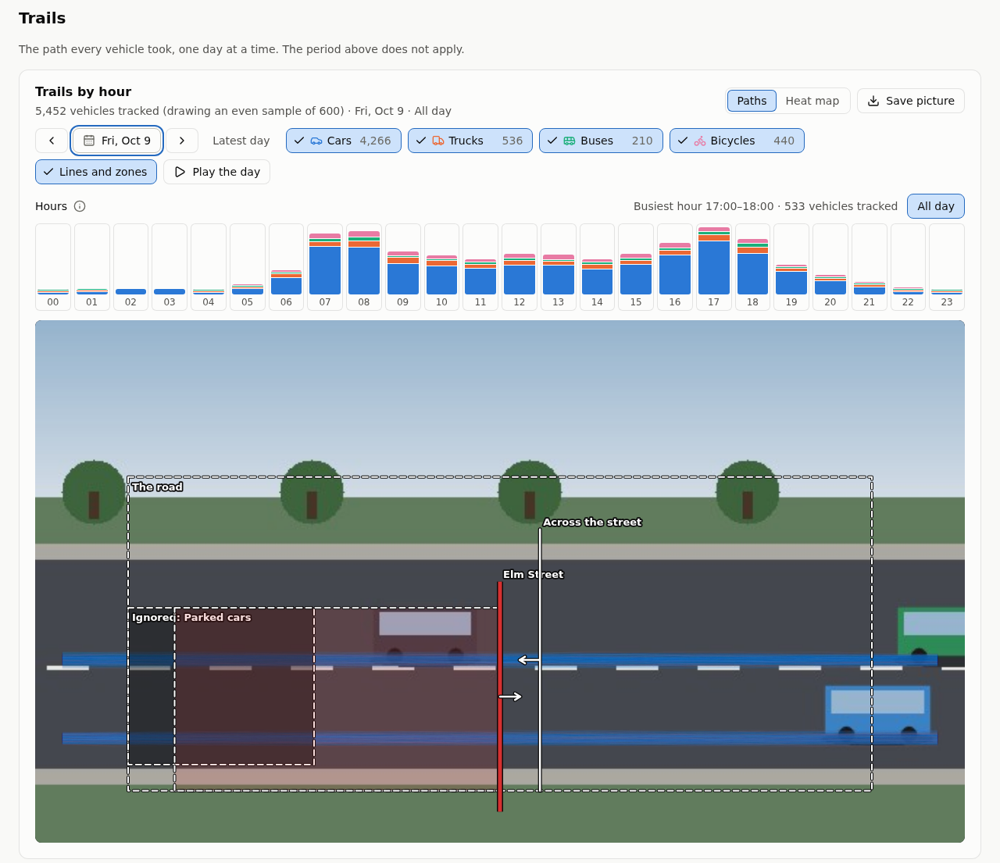
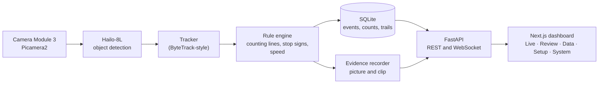

# TrafficPi

**AI-powered traffic monitoring and analytics, built with Raspberry Pi.**

[](https://github.com/Jet612/TrafficPi/actions/workflows/ci.yml)

TrafficPi is an open-source traffic monitoring system that uses computer vision and edge AI to detect, track, and analyze vehicles in real time.



*The dashboard on the made-up street that the tests and screenshots use ([docs/dev-setup.md](docs/dev-setup.md)). Nothing in the pictures is a real road.*

| | |
|---|---|
|  |  |
| *The Review page: the stop-sign passes that need a look, each with its picture and clip.* | *The Data page's Trails card: a day by the hour, and the path every vehicle took.* |

## At a glance

- **Edge AI on a Raspberry Pi 5.** A Hailo-8L accelerator detects vehicles at about 30 frames a second; a tracker of my own (ByteTrack-style) follows them; everything runs on the device and no video goes to a cloud service.
- **A rule engine you configure by drawing.** Counting lines, stop signs (approach zone and stop line), detection and exclusion zones, and a speed calibration are drawn on the camera picture in the browser and saved as a versioned profile, with undo and no code.
- **Stop-sign monitoring with evidence.** Each pass is judged as stopped, rolled through, did not stop, or unclear; those that need a look get a picture and a short clip and a review step.
- **Analytics.** Stop rates by hour, day, kind of vehicle and sign; traffic counts; the path every vehicle took, drawn as paths or a heat map; CSV downloads of the counts and the passes; an optional daily e-mail report.
- **Built to run unattended.** systemd services with a watchdog (it has restarted a hung camera loop on its own), a health history, nightly backups, a security pass on the API, and a remote-access guide.
- **Tested, and measured on a real street.** Over 2,000 backend tests and over 700 dashboard tests, a browser test that drives every page, and CI on GitHub that runs on every push. A 12-minute daylight recording of the real intersection was checked frame by frame: every count was a real vehicle, 22 of the 23 vehicles that crossed the picture were counted, and the rule agreed with the eye on 9 of 10 passes at the stop sign ([docs/accuracy.md](docs/accuracy.md), with what that does not show).



### Problems solved along the way

Short versions; [docs/dev-setup.md](docs/dev-setup.md) and [docs/operations.md](docs/operations.md) have the details.

- **Random crashes that were a defective RAM page.** Programs crashed or computed wrong results at random. A memory scan found one bad physical page; a device-tree overlay now keeps the kernel from using it, and a boot check confirms it.
- **A native library that crashes when it is closed.** HailoRT crashes a thread on teardown and again in its own exit code. The detector is never closed in a running process, and the service leaves through `os._exit`.
- **CI that passed on the Pi and failed on GitHub.** The Pi has libraries a runner does not. A rehearsal script now runs the four CI jobs from a fresh clone, and CI and the rehearsal start the test street with the same script.
- **A camera that hung.** The vision service reports to systemd's watchdog only while its loop makes progress; when the camera stopped delivering, the service was restarted and was counting again within about a minute.
- **Speed from one camera.** A homography from a measured rectangle on the road, an error estimate found by shaking the inputs, and pages that say the calibration has not been checked against vehicles of known speed until it has.
- **Privacy.** No plate reading, no face recognition; evidence is small, expires, and can be switched off.

### Getting started

**On a Raspberry Pi 5** with an AI HAT+ (Hailo-8L) and a Camera Module 3: flash Raspberry Pi OS Lite (64-bit, Debian 13), bring it up to date, and run

```
git clone https://github.com/Jet612/TrafficPi.git
cd TrafficPi
scripts/install.sh
```

then open `http://<the Pi>.local:8000`. [docs/install.md](docs/install.md) lists what you need and what the installer does, step by step.

**Without the hardware**, the same tracker, rules, database, API and dashboard run on a made-up street of drawn vehicles, on a laptop: [CONTRIBUTING.md](CONTRIBUTING.md) has the commands and [docs/dev-setup.md](docs/dev-setup.md) the details.

More: [docs/operations.md](docs/operations.md) (running it), [docs/security.md](docs/security.md) and [docs/accuracy.md](docs/accuracy.md) (what has been measured).

**Project status:** In development, and running on one Raspberry Pi 5 with a Hailo-8L and a Camera Module 3. It counts vehicles at counting lines, watches stop signs (a picture and a short clip of every pass that needs review), keeps the paths vehicles took, and shows all of it in a password-protected dashboard that also reports on the machine's health. It can e-mail a daily report of how the stop signs did. There is no tagged release yet, and some of what is built has not been proven:

- **Speeds.** Speed measurement is built but not yet checked against vehicles of known speed. Once the camera is calibrated on the Setup page ([docs/speed-calibration.md](docs/speed-calibration.md)) it gives each counted vehicle's speed and the stop-sign passes' speeds, and until a calibration has been checked every page says so. Before a calibration, the Data page and the e-mail give a rough estimate of the fastest speed at a stop sign, good to about 40%.
- **A clean install.** [docs/install.md](docs/install.md) takes a blank Raspberry Pi OS Lite card to a working system, but has not yet been tried on a clean image: it has been run on the development Pi, and its package names checked against a clean Debian root.
- **E-mail and remote access.** The daily e-mail was tried with a stand-in sender and not yet with a real mail provider's key; the Cloudflare route for remote access is written from its documentation and has not been tried with a real account.
- **Conditions.** The accuracy check is one 12-minute daylight clip of one street ([docs/accuracy.md](docs/accuracy.md)). Rain, low sun, glare, night and busy traffic have not been measured.

Not built, and listed as later work: several cameras at once, RTSP cameras, lane zones, a red-light mode, a night mode, the Hailo-10H (AI HAT+ 2), PostgreSQL, LAN TLS, MQTT or Home Assistant, and other languages.

---

## Overview

TrafficPi processes video from a connected camera using AI-powered object detection and vehicle tracking. It transforms camera footage into useful traffic statistics, including vehicle counts, traffic flow, estimated vehicle speeds, and potential traffic violations.

TrafficPi is designed to be configurable rather than hardcoded for one intersection.

Users customize their camera configuration directly from the web dashboard, defining road boundaries, monitoring zones, virtual stop lines, and traffic rules without writing code.

### Key Features

- **Real-Time Vehicle Detection:** Detect and classify cars, trucks, buses, motorcycles, and other supported objects.
- **Vehicle Tracking:** Track individual vehicles across frames to estimate movement and prevent duplicate counting.
- **Traffic Analytics:** Monitor traffic volume, directions, vehicle classifications, and trends over time.
- **Speed Estimation:** Estimate vehicle speeds using camera calibration and real-world distance measurements.
- **Stop-Sign Monitoring:** Identify vehicles that may have failed to stop at a configured stop line, around the clock or only in the hours you choose (in daylight, or at set times of day).
- **Custom Detection Zones:** Visually configure roads, lanes, intersections, and monitoring areas.
- **Web Dashboard:** View live traffic statistics, historical trends, camera feeds, and recorded events.
- **Remote Access:** Reach the dashboard from outside the local network through a VPN or a Cloudflare Tunnel, as [docs/remote-access.md](docs/remote-access.md) describes.
- **Daily Email Report:** Optionally e-mail a short report each day, with the number of vehicles that did not stop at the stop signs as its headline (numbers only; no pictures or clips are sent).
- **Local Processing:** Perform AI inference on the Raspberry Pi without sending continuous video to a cloud AI provider.

---

## How It Works

TrafficPi combines edge AI, computer vision, configurable traffic rules, and a web-based dashboard.

### 1. Camera Capture

A connected camera continuously captures video of the monitored roadway.

The initial hardware target is the Raspberry Pi Camera Module 3. Recorded video files (for testing and calibration) and network cameras may be supported as additional sources later.

### 2. AI Object Detection

Video frames are processed using a Hailo AI accelerator and a compatible object-detection model.

The system detects supported vehicle classes and identifies their positions within the frame.

### 3. Vehicle Tracking

Detected objects are assigned temporary tracking IDs.

By following vehicles across consecutive frames, TrafficPi can determine their trajectories, movement directions, approximate speeds, and interactions with configured monitoring zones.

### 4. Traffic Rule Processing

Tracked vehicles are evaluated against the rules configured for the camera.

Examples include:

- Counting vehicles crossing a virtual line.
- Measuring travel time between calibrated roadway locations.
- Checking whether vehicles stop before a configured stop line.

Each monitoring rule can be enabled or disabled independently.

### 5. Data Storage

TrafficPi stores traffic statistics and detected events locally.

Recorded data may include timestamps, vehicle classifications, directions, estimated speeds, event types, and optional evidence snapshots or short video clips.

### 6. Dashboard and Analytics

A web dashboard retrieves processed traffic information through the backend API.

Users can review live monitoring data, explore historical traffic patterns, configure cameras, and manage detection rules.

---

## Customizable Camera Configuration

**Customization is a core part of TrafficPi.**

Every camera installation is different. Camera height, viewing angle, road layout, traffic controls, and monitoring goals all affect how traffic should be analyzed.

Rather than relying on predefined intersection layouts, TrafficPi provides a visual configuration editor.

### Visual Zone Editor

The Setup page opens a camera preview, and monitoring areas are configured by drawing directly on the image.

The elements (lane zones are planned and not built yet):

| Element | Purpose |
|---|---|
| Detection Zone | Define where objects should be detected and monitored. |
| Counting Line | Count vehicles crossing a virtual line in a configured direction. |
| Stop Line | Define where vehicles must stop for stop-sign monitoring. |
| Lane Zone | Separate traffic into individual lanes and directions. (Planned.) |
| Speed Calibration | Configure real-world measurements and perspective correction. |
| Exclusion Zone | Ignore irrelevant areas, such as sidewalks or nearby parking lots. |

Users can drag, resize, reposition, and remove zones through the interface.

Camera configurations are saved as a versioned profile, with undo, and loaded automatically when the monitoring service starts; a running service picks up a saved change without a restart.

### Monitoring Modes

TrafficPi has three monitoring modes. They are not mutually exclusive; a camera profile can enable any combination of them.

**Traffic Counting Mode**

Designed for roadways where the primary goal is understanding vehicle movement.

Provides vehicle counts, classifications, travel directions, and hourly traffic trends.

No stop sign or traffic light is required.

**Stop-Sign Monitoring Mode**

Designed for intersections controlled by stop signs.

Users configure an approach zone, stop line, and stopping criteria. TrafficPi then evaluates vehicle movement to identify potential rolling stops or failures to stop.

The hours in which stop signs are judged can be limited, with a switch for each limit (Setup page, "Stop-sign hours"). **In daylight** judges from some minutes before sunrise to some minutes after sunset (30 and 30 to begin with), worked out from the camera's latitude and longitude with no network and no account, so it follows the seasons by itself; the card shows the sun's times for the place as it is typed. **At set times** judges only in ranges of the day you choose (more than one, and a range may run through midnight), on the days of the week you choose. With both on a pass must be inside both; with both off every pass is judged. Outside the hours nothing is recorded about a stop sign (no row, no picture, no clip), while vehicles are still counted at the counting lines and their paths still saved; the Stop signs card, the Data page and the daily email say that the hours are limited.

**Speed Monitoring Mode**

Designed for monitoring roadway speeds.

Users calibrate the camera using known ground distances and road geometry. TrafficPi estimates speeds from tracked vehicle movement and produces speed distributions and average-speed statistics.

Speed measurements are estimates and require calibration and validation.

### Camera Profiles

A camera's configuration is one profile: its zones, rules, calibration data, and settings. One active camera is supported.

These are the kinds of setup the same software suits, for example:

- **Residential Intersection:** Vehicle counting and stop-sign monitoring.
- **Main Road:** Vehicle counting, direction tracking, and speed estimation.
- **Parking Entrance:** Vehicle counting and entry/exit tracking.

A profile can be exported from the Setup page as a JSON file and imported again, to share a configuration or keep a copy; backups of the database include it.

This allows the same TrafficPi software to serve different locations without custom code changes.

---

## Web Dashboard

TrafficPi includes a responsive web interface built with modern web technologies.

### Dashboard Overview

The dashboard displays important metrics, including:

- Total vehicles detected today
- Vehicles detected per hour
- Estimated vehicle speeds (average, median, 85th percentile and fastest)
- Vehicle classification breakdown
- Suspected traffic violation counts
- Traffic direction distribution
- Camera and AI processor status

Interactive charts show trends over a selectable period: today, 7, 30 or 90 days, or all time.

The **Data** page does this for the stop signs and the traffic. Over today, 7, 30 or 90 days, or all time, it shows the share of vehicles that stopped, rolled through, did not stop or were unclear (the program could not tell), and how far each share moved since the days before; the busiest hour and day, and the hour and the kind of vehicle with the lowest stop rate; charts by hour of the day, day, day of the week, kind of vehicle and stop sign (each also as a table); how long a typical stop lasts and how slowly a typical roll goes; how many of the passes you have reviewed were false alarms; and the vehicles counted, by hour, day, kind and counting line.

### Live Camera View

The Live page provides a camera preview with optional overlays for:

- Vehicle bounding boxes
- Tracking IDs
- Detection and counting zones
- Stop lines
- Estimated vehicle speeds

Users can toggle visual overlays on or off.

### Events and History

Stop-sign passes are stored for review. The Review page lists them newest first, filtered by period, by outcome (stopped, rolled through, did not stop, unclear) and by whether they have been reviewed, and each pass can be confirmed or called a false alarm. The counts and the passes can be downloaded as CSV files from the Data page.


Where recording is enabled, supported events may include snapshots or short video clips for manual review. For stop signs, a vehicle that rolled through or did not stop gets a picture and a clip of about nine seconds around the moment it crossed the stop line, which you can watch and then confirm or call a false alarm; a vehicle that stopped gets none. The pictures are kept for 30 days or 2 GB unless you choose otherwise, but the clips of a rolled-through stop only for 3 hours and those of a vehicle that did not stop for 2 days (the counts stay). All of it can be switched off, and it is only as sharp as the detector's own picture (640 by 360 pixels), which is usually too small to read a number plate or a face (one very close to the camera can still be readable, so look at a few before you rely on that).

### Trails

TrafficPi saves the path every moving vehicle takes through the picture: a few hundred bytes of points, with no video, no face and no number plate. The Data page's Trails card shows a day, or any hours of it, as paths or as a heat map drawn over the camera picture, filtered by kind of vehicle, with the counting lines and zones on top. It plays a day hour by hour and saves the picture. It shows how the road is really used, and whether the lines and zones fit it. Trails are kept for a year unless you choose otherwise.

### Camera Management

The Setup page configures the camera: the monitoring zones, the stop-sign hours, the speed calibration, how long pictures, clips and trails are kept, and the daily e-mail.

The profile belongs to the camera. One active camera is supported; running several camera streams at once is a long-term goal, where hardware capacity permits.

---

## Technology Stack

TrafficPi uses Python for computer vision and traffic processing, with a TypeScript-based web interface.

| Layer | Technology |
|---|---|
| Hardware | Raspberry Pi 5 |
| Operating System | Raspberry Pi OS Lite 64-bit (Debian 13, Trixie) |
| Camera | Raspberry Pi Camera Module 3 |
| AI Accelerator | Raspberry Pi AI HAT+ (Hailo-8L, 13 TOPS; the 26 TOPS Hailo-8 is expected to work and has not been tried) |
| Camera Capture | Picamera2 / libcamera |
| AI Inference | HailoRT and compatible pre-compiled object-detection models |
| Vehicle Tracking | A ByteTrack-style tracker of its own, on NumPy and SciPy |
| Image Processing | OpenCV and NumPy |
| Backend | Python and FastAPI |
| Real-Time Updates | WebSockets |
| Database | SQLite, with PostgreSQL as a possible future option |
| Frontend | Next.js and TypeScript |
| UI Components | Tailwind CSS, with components of its own and Lucide icons |
| Data Visualization | Recharts |
| Frontend Packages | pnpm |
| Remote Access | A VPN such as Tailscale, or Cloudflare Tunnel with Cloudflare Access (both optional) |

Pre-compiled models are specific to the accelerator variant, so the inference implementation depends on the installed Hailo accelerator and supported software versions. The Raspberry Pi AI HAT+ 2 (Hailo-10H) uses a different runtime and is not targeted initially.

---

## System Architecture

TrafficPi is designed around three primary components.

**Vision Service**

Responsible for camera capture, accelerated AI inference, vehicle tracking, geometry calculations, and traffic event detection.

**Backend API**

Responsible for configuration management, event storage, traffic statistics, and communication with the web dashboard.

**Web Dashboard**

Responsible for visualizing traffic data, configuring camera installations, managing rules, and presenting historical analytics.

The processing pipeline follows this structure:

**Camera → AI Detection → Vehicle Tracking → Configurable Rule Engine → Database → API → Dashboard**

The vision service runs locally on the Raspberry Pi. The dashboard can be accessed on the local network or remotely through an authenticated web connection.

---

## Remote Access

On the local network the dashboard is at `http://<the Pi>.local:8000`; everything needs the login. For access from outside, [docs/remote-access.md](docs/remote-access.md) describes two ways: a VPN such as Tailscale (nothing is exposed), or a Cloudflare Tunnel with Cloudflare Access in front (viewers need no VPN). Cloudflare's terms let it limit video on its network, so viewers who come through it get a still picture renewed every few seconds instead of the live video unless the owner switches that on in Settings. The Cloudflare route is written from its documentation and has not been tried with a real account yet.

Nothing is public by default, and Cloudflare is an option, not a requirement. What is and is not protected is in [docs/security.md](docs/security.md).

---

## Privacy and Accuracy

TrafficPi is intended for traffic research, educational use, and general traffic monitoring.

The project prioritizes local processing and configurable data retention. Aggregate statistics can be retained separately from identifiable footage, and video recording can be disabled.

TrafficPi does not read license plates and does not recognize faces or identify individual people or vehicles. It classifies road users by kind (car, truck, bus, motorcycle, bicycle, person) so that it can count them. Looking for people at all can be switched off in the dashboard's Settings, and then they get no box, no path and no count.

If you use the daylight limit, the camera's latitude and longitude are kept in the settings (so in the database and its backups) and used only to work out sunrise and sunset; they are not sent anywhere, and two decimals (about a kilometre) is plenty.

TrafficPi is not intended to function as a certified speed enforcement system or automatically issue traffic citations.

Speed estimates and suspected violations may be inaccurate due to camera perspective, occlusion, lighting, tracking failures, signal visibility, or calibration errors. Events requiring a legal or safety determination should be reviewed independently.

Users are responsible for complying with applicable recording, surveillance, and privacy laws.

---

## Project Goals

TrafficPi is being developed as both a practical traffic analytics tool and an open-source software engineering project.

The main goals are to:

1. Build a reliable end-to-end computer vision application using accessible hardware.
2. Make traffic analytics configurable enough to support a variety of road layouts.
3. Provide an intuitive interface that does not require users to modify source code.
4. Keep core detection and processing local to the device.
5. Make installation, configuration, and troubleshooting approachable for other developers.
6. Develop a modular architecture that can grow with additional AI models, camera sources, and monitoring capabilities.

---

## Contributing

Bug reports, feature ideas and pull requests are welcome. [CONTRIBUTING.md](CONTRIBUTING.md) says what the project will and will not take, how to run the tests (most work needs no hardware) and how to report a security problem.

Installing is in [docs/install.md](docs/install.md), running it in [docs/operations.md](docs/operations.md), and the development machine in [docs/dev-setup.md](docs/dev-setup.md).

---

## License

TrafficPi's code is released under the [MIT License](LICENSE).

The detection models are not part of this repository, and the MIT License does not cover them. Each has a license of its own:

| Model | Where it comes from | Built from | License of the original |
|---|---|---|---|
| `yolov11s`, the default | Hailo's Model Zoo, downloaded by `scripts/fetch_model.sh` (the installer runs it) | Ultralytics YOLO11 | [AGPL-3.0](https://www.ultralytics.com/license), or an Enterprise License from Ultralytics |
| `yolov8s`, used when `yolov11s` is missing | Raspberry Pi's `hailo-models` package | Ultralytics YOLOv8 | [AGPL-3.0](https://www.ultralytics.com/license), or an Enterprise License from Ultralytics |
| `yolox_s_leaky` | Raspberry Pi's `hailo-models` package | Megvii's YOLOX | Apache-2.0 |

Whether the license of the original reaches a model compiled for the Hailo chip is not settled; read the terms if they matter to how you use TrafficPi. Another model runs with `trafficpi-vision run --hef PATH` (for example `/usr/share/hailo-models/yolox_s_leaky_h8l_rpi.hef` on a Hailo-8L); [docs/operations.md](docs/operations.md#the-detection-model) says how to make the service run it, and [docs/accuracy.md](docs/accuracy.md) compares the models on a real street.

HailoRT, its driver, Picamera2 and libcamera are Raspberry Pi OS packages that the installer installs with `apt`. They are not part of this repository either, and come under their own licenses.
